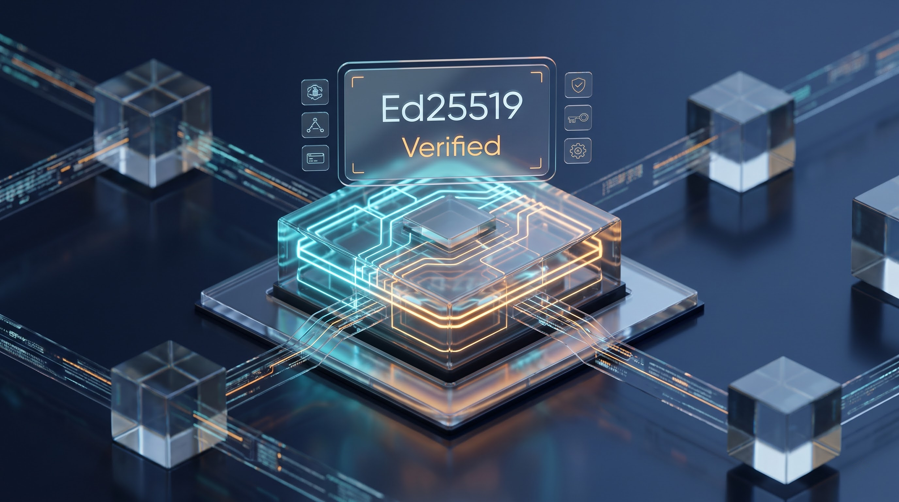
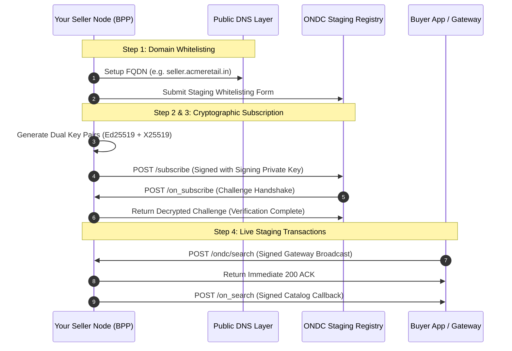

<p align="center">
  
</p>

# ondc-light-sdk

<p align="center">
  <a href="https://opensource.org/licenses/MIT"></a>
  <a href="https://nodejs.org/"></a>
  <a href="https://www.typescriptlang.org/"></a>
  <a href="https://becknprotocol.io/"></a>
  <a href="#running-tests"></a>
</p>

<p align="center">
  <video src="./assets/ondc-light-sdk-video.mp4" width="100%" controls poster="./assets/ondc-light-sdk-image.png">
    <a href="./assets/ondc-light-sdk-video.mp4">▶️ Watch the Motion Design Video Walkthrough</a>
  </video>
</p>

A lightweight, production-ready, open-source Node.js and TypeScript SDK wrapper for **India's Digital Public Infrastructure (DPI)** and the **Beckn / ONDC Protocol**.

`ondc-light-sdk` abstracts away the steep cryptographic and contextual complexities of the Open Network for Digital Commerce (ONDC):
- **Cryptographic Ed25519 Request Signing & Verification** with BLAKE-512 (Blake2b) hashing.
- **Header Parsing**: Automatic parsing and verification of ONDC `Authorization: Signature ...` HTTP headers.
- **Gateway & BAP Request Interception**: Contextual syntax validation and clean extraction of Beckn transaction parameters.
- **Legal Beckn Payload Construction**: Flawless transformation from simple flat product arrays into nested ONDC `on_search` catalog schemas (`bpp/descriptor`, `bpp/providers`, and `items`).
- **Zero-shorthand, strictly typed code**: Built in pure TypeScript with full ESM support.

---

## Repository Structure

```text
ondc-light-sdk/
├── package.json               # Package configurations with modern dependency scopes
├── tsconfig.json              # TypeScript compilation configuration
├── src/
│   ├── index.ts               # Main entry point exporting the core classes and crypto helpers
│   ├── OndcCrypto.ts          # Cryptographic Ed25519 & BLAKE-512 signing/verification engine
│   ├── OndcSellerNode.ts      # Primary Seller Node engine managing ONDC actions
│   └── types.ts               # Strict TypeScript definitions for Beckn schemas
├── test/
│   └── sdk.test.js            # Unit and end-to-end integration test suite
└── examples/
    └── express-seller/
        ├── server.js          # Working Express app demonstrating mock /search & /on_search
        └── package.json
```

---

## Installation

```bash
npm install ondc-light-sdk libsodium-wrappers axios
```

---

## Quickstart

### 1. Initialize the Seller Node

```typescript
import { OndcSellerNode } from 'ondc-light-sdk';

const seller = new OndcSellerNode({
  subscriberId: 'seller-store.staging.ondc.org',
  uniqueKeyId: 'seller-key-1',
  privateKey: process.env.ONDC_PRIVATE_KEY!, // Ed25519 Base64 secret key
  publicKey: process.env.ONDC_PUBLIC_KEY!,   // Ed25519 Base64 public key
  gatewayUrl: 'https://staging.gateway.ondc.org',
  bppId: 'seller-store.staging.ondc.org',
  bppUri: 'https://seller.example.com/ondc',
  domain: 'ONDC:RET10',
  country: 'IND',
  city: 'std:080',
});
```

### 2. Handle Incoming Search Queries (`/search`)

```typescript
import express from 'express';
import { OndcSellerNode } from 'ondc-light-sdk';

const app = express();
app.use(express.json());

app.post('/ondc/search', async (req, res) => {
  try {
    // 1. Intercept and parse incoming ONDC request bundle
    const { transactionId, messageId, searchIntent, bapUri, bapId } =
      seller.parseIncomingRequest(req);

    // 2. Respond immediately with Beckn ACK (within 5 seconds)
    res.status(200).json({ message: { ack: { status: 'ACK' } } });

    // 3. Find matching products in local database
    const localProducts = await getProductsFromDB(searchIntent);

    // 4. Asynchronously sign and dispatch on_search callback
    await seller.sendOnSearch({
      transactionId,
      messageId,
      bapUri,
      bapId,
      items: localProducts,
      providerId: 'SELLER-STORE-01',
      providerName: 'Bharat Direct Grocery Store',
    });
  } catch (err) {
    res.status(400).json({
      message: { ack: { status: 'NACK' } },
      error: { message: err.message },
    });
  }
});
```

---

## Cryptographic Engine: `OndcCrypto`

ONDC mandates strict cryptographic authentication for every network call between Network Participants (NPs):

1. **Payload Digest**: Computes a 64-byte `BLAKE-512` hash of the stringified JSON body and base64-encodes it.
2. **Canonical Signing String**:
   ```text
   (created): 1792589647
   (expires): 1792593247
   digest: BLAKE-512=VcEUNe6v...
   ```
3. **Ed25519 Signature**: The canonical string is signed with the participant's Ed25519 private key.
4. **Authorization Header**:
   ```http
   Authorization: Signature username="[subscriberId]|[uniqueKeyId]|ed25519", algorithm="ed25519", created="1792589647", expires="1792593247", headers="(created) (expires) digest", signature="[base64_signature]"
   ```

### Standalone Crypto Utilities

```typescript
import {
  generateKeyPair,
  generateAuthorizationHeader,
  verifyAuthorizationHeader,
} from 'ondc-light-sdk';

// Generate a fresh Ed25519 keypair
const { publicKey, privateKey } = await generateKeyPair();

// Create an authorization header
const authHeader = await generateAuthorizationHeader({
  body: { test: 'payload' },
  privateKey,
  subscriberId: 'my-subscriber.org',
  uniqueKeyId: 'key-1',
  ttl: 3600,
});

// Verify an incoming authorization header
const isValid = await verifyAuthorizationHeader({
  header: authHeader,
  body: { test: 'payload' },
  publicKey,
});
console.log('Signature Valid:', isValid); // true
```

---

## Running the Example Application

A fully functional, self-contained Express seller example is included in `examples/express-seller`:

```bash
# 1. Build the SDK
npm run build

# 2. Run the Express seller example
node examples/express-seller/server.js
```

The example launches:
- `POST /ondc/search`: Main ONDC search router.
- `POST /mock-bap/on_search`: Mock BAP node demonstrating live signature verification.
- `GET  /trigger-test-search?q=coffee`: Simulates a full end-to-end Beckn search and signed `on_search` round-trip.

Test it via curl or browser:
```bash
curl "http://localhost:3000/trigger-test-search?q=coffee"
```

---

## Running Tests

The SDK includes a comprehensive test suite using Node's native test runner (`node:test`):

```bash
npm test
```

### Coverage:
- `OndcCrypto`: Keypair generation, Blake2b digest calculation, signature header generation, round-trip verification, tampered payload rejection, and timestamp expiry checking.
- `OndcSellerNode`: Request interception, syntax validation, error boundaries, flat-to-Beckn item mapping.
- `E2E Integration`: Real Express server dispatching signed `on_search` payloads and verifying signatures.

---

## 🚀 ONDC Staging Network Onboarding & Testing Guide

This guide walks you through the exact end-to-end process of taking your **Seller Application (BPP)** from local development to the live **ONDC Staging Network Registry**.



---

### 🌐 STEP 1: SUBSCRIBER ID WHITELISTING (DNS LAYER)

Every Network Participant (NP) on ONDC must possess an authentic, verifiable **public DNS Fully Qualified Domain Name (FQDN)**.

1. **Domain Name as Identity**:
   * In Beckn and ONDC specifications, your public domain **is your permanent `Subscriber ID`** (e.g., `seller.acmeretail.in`).
   * IP addresses, localhost URLs, or non-resolvable hostnames are **strictly rejected** by the staging gateway filters.
   * Ensure your DNS has valid `A` or `CNAME` records pointing to your staging reverse-proxy or tunnel ingress.

2. **Official Whitelisting Form Workflow**:
   * Navigate to the **[ONDC Staging Network Participant Whitelisting Portal](https://ondc.org)**.
   * Submit your official registration request with the following parameters:
     * **Legal Entity Name**: Registered business name matching legal incorporation.
     * **Role**: Select **BPP (Buyer-side / Provider-side Seller App)**.
     * **Subscriber ID (Domain)**: Exact FQDN (e.g., `seller.acmeretail.in`).
     * **Network Category / Domain**: Retail (`ONDC:RET10`), Food & Beverage (`ONDC:RET11`), Logistics (`ONDC:LOG10`), or Mobility.
   * **Approval Timeline**: Staging whitelisting approval typically resolves in **4 to 6 hours** during standard network operations.

> [!NOTE]
> During staging onboarding, keep your domain's SSL/TLS certificates active (HTTPS). Even in staging, non-TLS HTTP endpoints are blocked by the ONDC routing security boundary.

---

### 🔑 STEP 2: GENERATING THE DUAL ED25519 KEY PAIRS

ONDC protocol separation requires two distinct cryptographic key pairs:
1. **Signing Key Pair (Ed25519)**: Affixes digital signatures to every outbound HTTP `Authorization` request header and verifies incoming gateway webhooks.
2. **Encryption Key Pair (X25519 / Diffie-Hellman)**: Decrypts private transactional challenge tokens and secures end-to-end messaging payloads.

Run this self-contained Node.js script using `libsodium-wrappers` to generate both pairs in one command:

```bash
node -e "
import('libsodium-wrappers').then(async ({ default: sodium }) => {
  await sodium.ready;

  // 1. Generate Ed25519 Digital Signing Key Pair
  const signingPair = sodium.crypto_sign_keypair();
  const signingPublicKey = sodium.to_base64(signingPair.publicKey, sodium.base64_variants.ORIGINAL);
  const signingPrivateKey = sodium.to_base64(signingPair.privateKey, sodium.base64_variants.ORIGINAL);

  // 2. Generate X25519 Diffie-Hellman Encryption Key Pair
  const encPair = sodium.crypto_box_keypair();
  const encryptionPublicKey = sodium.to_base64(encPair.publicKey, sodium.base64_variants.ORIGINAL);
  const encryptionPrivateKey = sodium.to_base64(encPair.privateKey, sodium.base64_variants.ORIGINAL);

  console.log('\n================== [ONDC DUAL KEY PAIRS] ==================');
  console.log('\n[1] ED25519 SIGNING KEYS (HTTP Request Headers):');
  console.log('  SIGNING_PUBLIC_KEY  =', signingPublicKey);
  console.log('  SIGNING_PRIVATE_KEY =', signingPrivateKey);

  console.log('\n[2] X25519 ENCRYPTION KEYS (Registry Challenge & Payloads):');
  console.log('  ENCRYPTION_PUBLIC_KEY  =', encryptionPublicKey);
  console.log('  ENCRYPTION_PRIVATE_KEY =', encryptionPrivateKey);
  console.log('===========================================================\n');
});
"
```

> [!CAUTION]
> **CRITICAL SECURITY WARNING**:
> - Never commit `SIGNING_PRIVATE_KEY` or `ENCRYPTION_PRIVATE_KEY` to public source control.
> - Store private keys inside environment variables (`.env`) or cloud hardware security modules (HSMs).
> - Only the **Public Keys** (`SIGNING_PUBLIC_KEY` & `ENCRYPTION_PUBLIC_KEY`) are submitted to the registry.

---

### 🛰️ STEP 3: EXECUTING THE SELF-ONBOARDING SUBSCRIBE API

Once your domain is whitelisted, register your public keys with the live **ONDC Staging Registry** (`https://staging.registry.ondc.org/subscribe`).

#### 1. Registration Payload Configuration (`subscribe.json`)

```json
{
  "context": {
    "operation": {
      "ops_no": 1
    }
  },
  "message": {
    "entity": {
      "gst": {
        "legal_entity_name": "Acme Retail Commerce Private Limited",
        "business_address": "Indiranagar 100ft Road, Bengaluru, Karnataka, 560038",
        "city_code": ["std:080"],
        "gst_no": "29ABCDE1234F1Z5"
      },
      "pan": {
        "name_as_per_pan": "Acme Retail Commerce Private Limited",
        "pan_no": "ABCDE1234F",
        "date_of_incorporation": "2022-06-15"
      },
      "name_of_authorised_signatory": "Aditya Verma",
      "address_of_authorised_signatory": "Bengaluru, Karnataka, 560038",
      "email_id": "tech-infra@acmeretail.in",
      "mobile_no": "9876543210",
      "country": "IND",
      "subscriber_id": "seller.acmeretail.in",
      "unique_key_id": "key-2026-v1",
      "callback_url": "/on_subscribe",
      "key_pair": {
        "signing_public_key": "W0Kd5MZ4DTWoMn7MuHoTazo9XXp2WDOZO+rULYOkRqM=",
        "encryption_public_key": "nKk927mYp49bOq4N6B+HhZ5Vb+8wQeR1JmS2v8c=",
        "valid_from": "2026-10-21T00:00:00.000Z",
        "valid_until": "2027-10-21T00:00:00.000Z"
      }
    },
    "network_participant": [
      {
        "subscriber_id": "seller.acmeretail.in",
        "type": "bpp",
        "cb_url": "https://seller.acmeretail.in/ondc",
        "domain": "ONDC:RET10",
        "status": "INITIATED",
        "seller_on_record": [],
        "msn": false,
        "city_code": ["std:080"]
      }
    ]
  }
}
```

#### 2. The Cryptographic Subscription Request

Before posting to the registry, sign the payload using `ondc-light-sdk`:

```javascript
import axios from 'axios';
import { generateAuthorizationHeader } from 'ondc-light-sdk';

const payload = JSON.parse(await readFile('./subscribe.json', 'utf-8'));

// 1. Sign the registration payload
const authHeader = await generateAuthorizationHeader({
  body: payload,
  privateKey: process.env.SIGNING_PRIVATE_KEY,
  subscriberId: 'seller.acmeretail.in',
  uniqueKeyId: 'key-2026-v1',
  ttl: 300,
});

// 2. Dispatch to ONDC Staging Registry
const res = await axios.post('https://staging.registry.ondc.org/subscribe', payload, {
  headers: {
    'Content-Type': 'application/json',
    Authorization: authHeader,
  },
});

console.log('Registry Subscription Status:', res.data);
```

#### 3. Challenge Decryption Handshake (`/on_subscribe`)
The registry validates your encryption key by calling your `callback_url` (`/on_subscribe`) with an encrypted challenge string:

```javascript
app.post('/on_subscribe', async (req, res) => {
  const { challenge } = req.body;
  const sodium = await ensureSodiumReady();

  // Decrypt challenge string using your X25519 encryption private key
  const decrypted = sodium.crypto_box_seal_open(
    sodium.from_base64(challenge),
    sodium.from_base64(process.env.ENCRYPTION_PUBLIC_KEY),
    sodium.from_base64(process.env.ENCRYPTION_PRIVATE_KEY),
    'text'
  );

  // Return the decrypted challenge to verify ownership
  res.status(200).json({ answer: decrypted });
});
```

---

### 🧪 STEP 4: VERIFYING MOCK SEARCH TRANSACTIONS

After registry activation, verify that incoming Beckn requests are parsed and answered without latency blocks.

#### 1. Configure the Seller Node with Active Staging Credentials

Update your local application configuration:

```typescript
import { OndcSellerNode } from 'ondc-light-sdk';

const seller = new OndcSellerNode({
  subscriberId: 'seller.acmeretail.in',
  uniqueKeyId: 'key-2026-v1',
  publicKey: process.env.SIGNING_PUBLIC_KEY!,
  privateKey: process.env.SIGNING_PRIVATE_KEY!,
  gatewayUrl: 'https://staging.gateway.ondc.org',
  bppId: 'seller.acmeretail.in',
  bppUri: 'https://seller.acmeretail.in/ondc',
  domain: 'ONDC:RET10',
  country: 'IND',
  city: 'std:080',
  ttl: 'PT30S',
});
```

#### 2. Execute a Simulated Gateway `/search` via Curl

Execute a curl command simulating a Buyer App (BAP) broadcast:

```bash
curl -X POST http://localhost:3000/ondc/search \
  -H "Content-Type: application/json" \
  -d '{
    "context": {
      "domain": "ONDC:RET10",
      "country": "IND",
      "city": "std:080",
      "action": "search",
      "core_version": "1.2.0",
      "bap_id": "buyer-app.staging.ondc.org",
      "bap_uri": "http://localhost:3000/mock-bap",
      "transaction_id": "txn_prod_882910471",
      "message_id": "msg_prod_991823714",
      "timestamp": "2026-10-21T14:30:00.000Z",
      "ttl": "PT30S"
    },
    "message": {
      "intent": {
        "item": {
          "descriptor": {
            "name": "coffee"
          }
        },
        "fulfillment": {
          "type": "Delivery",
          "end": {
            "location": {
              "gps": "12.9715987,77.5945627",
              "address": {
                "area_code": "560001"
              }
            }
          }
        }
      }
    }
  }'
```

#### 3. Expected Verified Response & Logs

1. **Immediate ACK Response (< 100ms)**:
   ```json
   {
     "message": {
       "ack": {
         "status": "ACK"
       }
     }
   }
   ```
2. **Terminal Execution Traces**:
   ```text
   ==================== [ONDC INCOMING /search] ====================
   [SDK] Parsed Request Context:
     - Transaction ID : txn_prod_882910471
     - Message ID     : msg_prod_991823714
     - BAP URI        : http://localhost:3000/mock-bap
     - Search Intent  : { item: { descriptor: { name: "coffee" } }, ... }
   [Catalog] Found 1 matching products for query.
   [SDK] Dispatching signed on_search callback to: http://localhost:3000/mock-bap/on_search

   ==================== [MOCK BAP RECEIVED /on_search] ====================
   [Mock BAP] Authorization Header:
     Signature username="seller.acmeretail.in|key-2026-v1|ed25519", algorithm="ed25519", created="1792589647", expires="1792593247", headers="(created) (expires) digest", signature="VcEUNe6v2ayfSXHBhfWR49rMQ5e8..."
   [Mock BAP] Cryptographic Signature Valid: ✅ VERIFIED
   [Mock BAP] Received Catalog Item Count: 1
     [1] Araku Valley Organic Arabica Filter Coffee (250g) - ₹340.00
   [SDK] on_search dispatch completed successfully. (Status: 200)
   ```

---

## License

MIT License. Designed for India's Digital Public Infrastructure and Beckn Protocol ecosystems.

